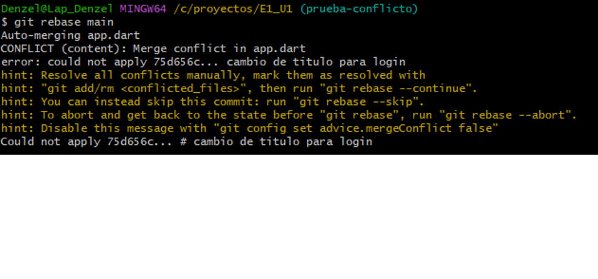
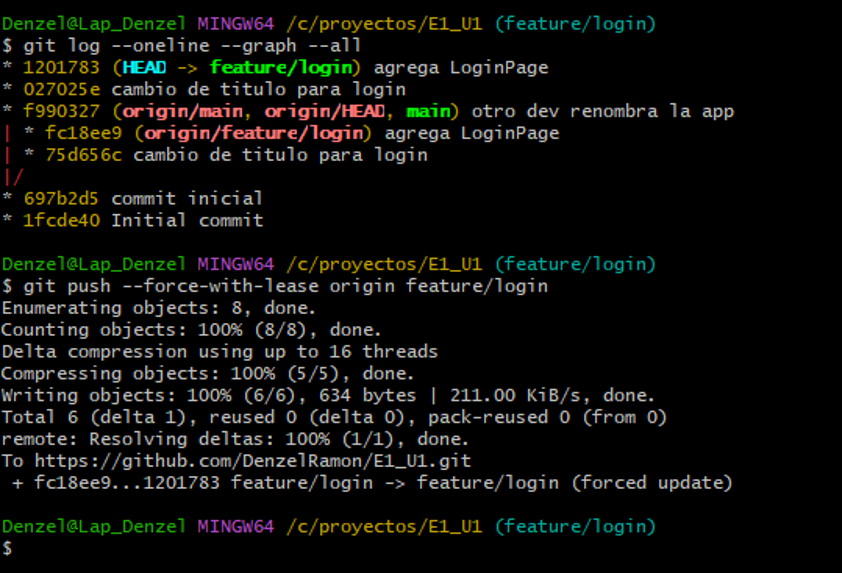
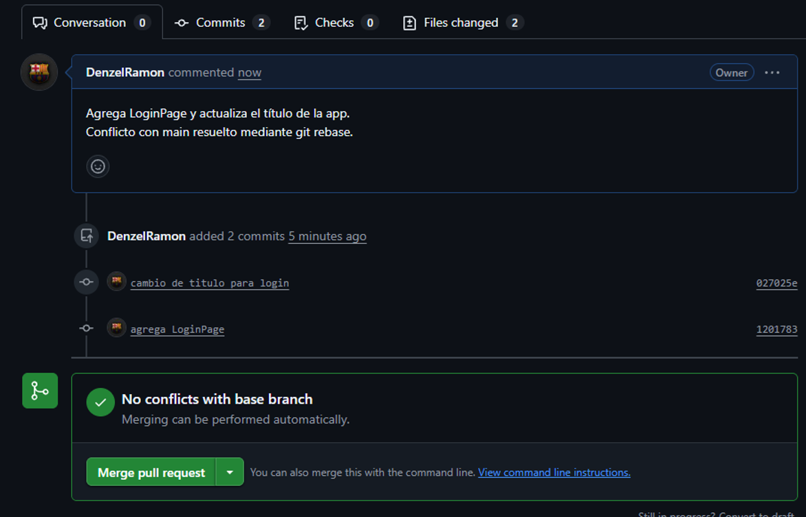
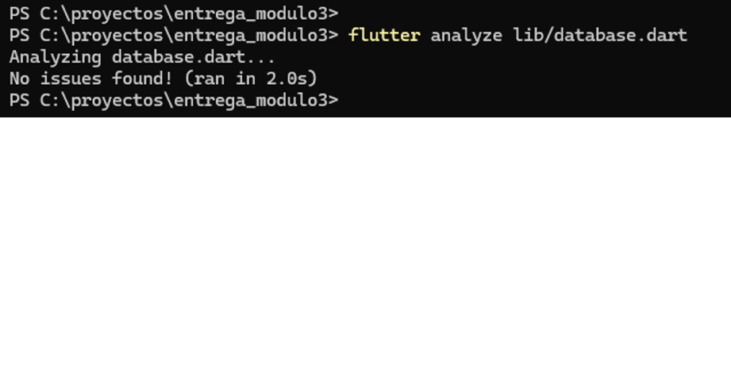
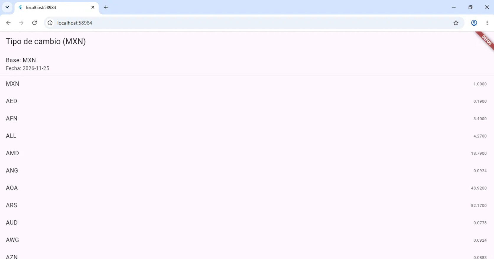
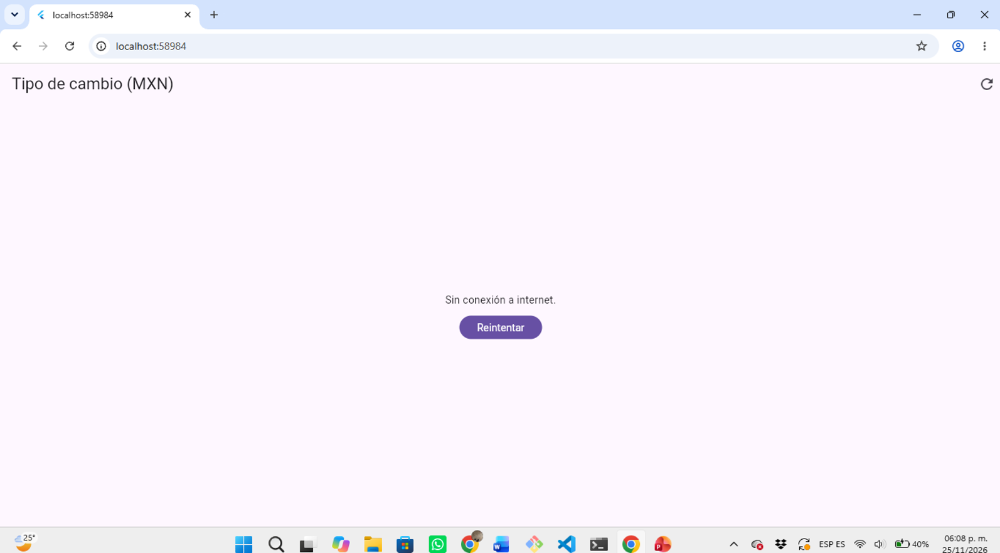
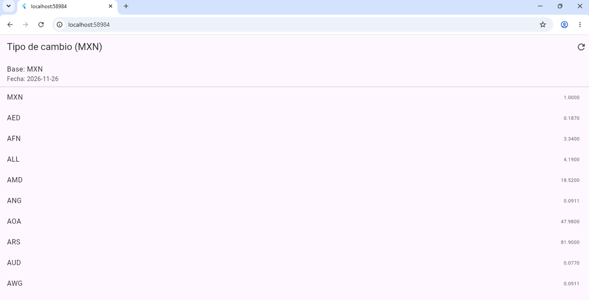
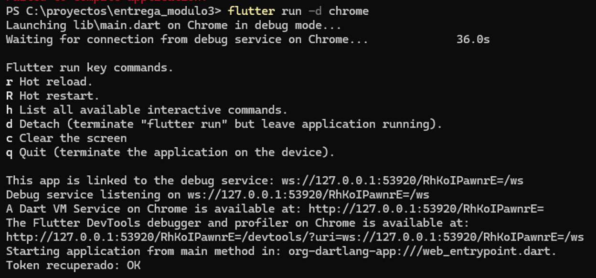

# Entrega Módulo 3 – Desarrollo de aplicaciones móviles

**Alumno:** [Denzel Ramon Alejandro]
**Materia:** Desarrollo de aplicaciones móviles
**Fecha:** 25/11/2026

Este repositorio es un proyecto Flutter. El código de los ejercicios está en la carpeta `lib/` y las evidencias en `capturas/`.

| Ejercicio | Archivo |
|---|---|
| 3.1 Git avanzado | Repositorio y Pull Request (enlace abajo) |
| 3.2 Base de datos local | `lib/database.dart` (+ `lib/database.g.dart` generado) |
| 3.3 Consumo de API | `lib/main.dart` |
| 3.4 Seguridad | `lib/token_storage.dart` |

---

## Ejercicio 3.1 – Git avanzado

Se creó un repositorio con un commit inicial, la rama `feature/login` con 2 commits, y se simuló que otro desarrollador modificó la misma línea de `app.dart` en `main`. Al hacer `git rebase main` apareció el conflicto, se resolvió a mano y se continuó con `git rebase --continue`. Después se subió la rama con `git push --force-with-lease` y se creó el Pull Request.

- **Repositorio:** https://github.com/DenzelRamon/E1_U1
- **Pull Request:** https://github.com/DenzelRamon/E1_U1/pull/1

Conflicto durante el rebase:


Historial después de resolverlo:


Pull Request creado:


---

## Ejercicio 3.2 – Base de datos local (Flutter + Drift)

**Modelo de datos**
- `Notas`: id, titulo, contenido, fecha, categoriaId (llave foránea hacia `Categorias`).
- `Categorias`: id, nombre, color.

**DAO (`NotasDao`)**
`watchNotasPorCategoria(int categoriaId)` devuelve las notas de una categoría ordenadas por fecha de la más reciente a la más antigua. Equivale a:

```sql
SELECT * FROM notas WHERE categoria_id = ? ORDER BY fecha DESC
```

El código se generó con `dart run build_runner build` y se verificó con `flutter analyze lib/database.dart`.

**Nota:** este ejercicio se verificó con análisis estático; no se ejecutó con datos reales.



---

## Ejercicio 3.3 – Consumo de API con Dio

Se hace un GET a `https://api.exchangerate-api.com/v4/latest/MXN`, el JSON se convierte al modelo `ExchangeRates` y se muestra en una lista. Los errores de red (timeout, sin conexión, 404, 5xx) se traducen a mensajes claros, y la pantalla de error incluye un botón **Reintentar**. La app también tiene un botón para actualizar los datos.

Datos cargados:


Error de red (modo Offline):


Recuperación al volver la conexión:


---

## Ejercicio 3.4 – Seguridad (almacenamiento del token)

La clase `TokenStorage` usa `flutter_secure_storage` para guardar, leer y borrar un token JWT. En Android el plugin cifra con una clave del Android Keystore y en iOS usa el Keychain. El archivo también incluye, como comentarios, los equivalentes nativos en Kotlin (`EncryptedSharedPreferences`) y Swift (Keychain Services).

**Notas:**
- En la versión 11.x del plugin el parámetro `encryptedSharedPreferences` fue eliminado; el plugin cifra por defecto con el Keystore.
- La prueba se ejecutó en Chrome, donde el token se guarda cifrado en el almacenamiento del navegador, no en el Keystore ni en el Keychain.



---

## Cómo ejecutar el proyecto

```bash
flutter pub get
dart run build_runner build
flutter run -d chrome
```
